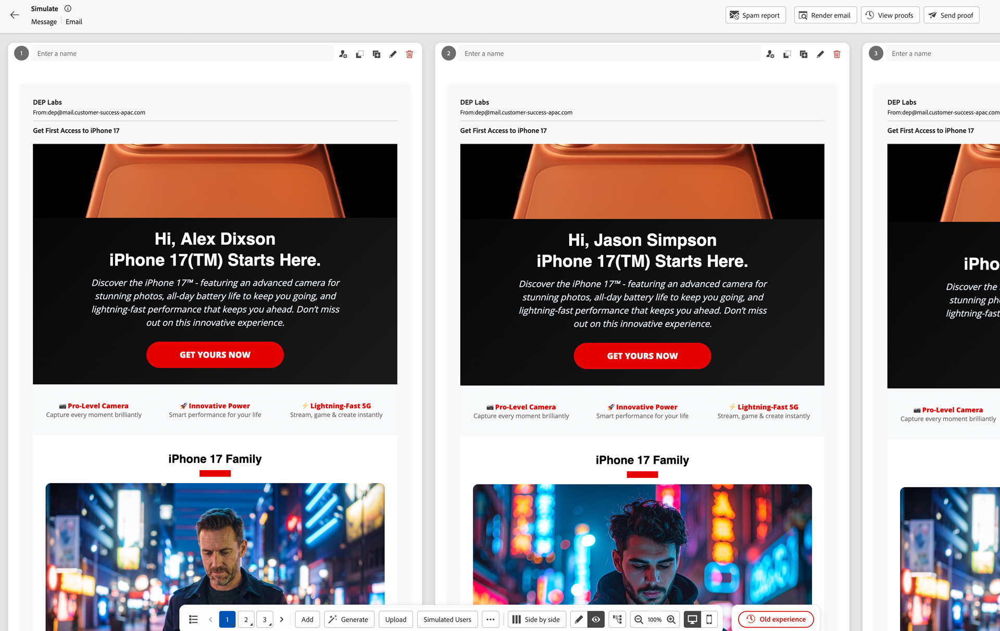

# 콘텐츠 시뮬레이션

**목적:** Adobe Journey Optimizer의 시뮬레이션 및 증명 도구를 사용하여 개인화, 조건부 논리 및 콘텐츠 변형을 확인합니다.

## 학습 목표

이 단원을 마치면 다음과 같은 작업을 수행할 수 있습니다.

1. 시뮬레이션을 위해 테스트 프로필 데이터를 업로드하고 사용합니다.
1. 개인화된 필드 및 변형 논리의 유효성을 검사합니다.
1. 누락되었거나 일치하지 않는 데이터에 대한 대체 동작을 테스트합니다.

## 소개

이 모듈에서는 Adobe Journey Optimizer의 시뮬레이션 도구를 사용하여 **2개의 조건부 변형**을 사용하여 전자 메일을 테스트합니다.
이렇게 하면 다양한 고객이 개인화된 메시지를 어떻게 경험할지 미리 볼 수 있으므로 캠페인을 시작하기 전에 정확성을 확보할 수 있습니다.

툴킷에서 샘플 테스트 프로필 파일 **sample.csv**&#x200B;을 사용합니다.

## 시뮬레이션 도구 열기

1. 완료된 이메일을 엽니다.
2. 이메일에서 **콘텐츠 시뮬레이션**&#x200B;을 클릭합니다.

몇 초 후에 시뮬레이션 패널이 열립니다.

## 테스트 프로필 데이터 업로드

1. 하단의 **업로드**&#x200B;를 클릭하여 입력 데이터를 업로드합니다.

   

3. **sample.csv**&#x200B;을 선택하고 **계속**&#x200B;을 클릭합니다.

   

AJO은 파일을 처리하고 적시에 미리 보기를 준비합니다.

## 변형 렌더링 검토

이메일에서 콘텐츠 시뮬레이트 를 클릭하면 AJO에 업로드된 프로필을 기반으로 하는 변형이 나란히 표시됩니다.

**예상 결과:**

- **Alex** → **Variant 1**(40세 이상) 표시
**변형 세부 정보를 표시**&#x200B;할 첫 번째 변형 위에 있는 연필 아이콘을 클릭합니다.

카드가 전환되어 개인화의 기반이 되는 세부 정보가 표시됩니다

- **Jason** → **Variant 2**(40세 미만) 표시
두 번째 변형 위에 있는 연필 아이콘을 클릭하여 **변형 세부 정보 표시**

보기를 나란히 **세로 스택**(으)로 바꾸면 Jason의 세부 정보와 개인화를 나란히 볼 수 있습니다

이메일 콘텐츠를 스크롤할 때 Jason의 전체 이름 및 선택한 조건부 콘텐츠 이미지를 볼 수 있습니다. 정말 멋지다!

## 대체 동작 확인

**폴백 및 기본값:** 전자 메일이 누락된 데이터 또는 일치하지 않는 시나리오를 정상적으로 처리하는지 확인하십시오. 예를 들어, 빈 생년 필드가 있는 프로필 또는 타겟팅된 오퍼에 적합하지 않은 프로필을 시뮬레이션하십시오. 미리 보기에는 깨지거나 빈 콘텐츠 대신 기본 콘텐츠 블록 또는 현명한 자리 표시자가 표시되어야 합니다. 시뮬레이션에 콘텐츠가 있어야 하는 빈 섹션이 표시되는 경우 디자인에서 대체 오퍼 또는 기본 텍스트를 구성해야 할 수 있음을 나타냅니다.

## 요약

이 단원에서는 다음과 같은 작업을 성공적으로 수행합니다.

- 샘플 프로필을 사용하여 개인화된 콘텐츠 시뮬레이션
- 검증된 변형 스위칭 논리
- 확인된 개인화된 필드가 올바르게 채워짐

이제 다음 모듈(**브랜드 정렬**)을 사용할 준비가 되었습니다.
여기서 AI를 사용하여 연결 5G 브랜드 지침에 대해 이메일을 평가합니다.
